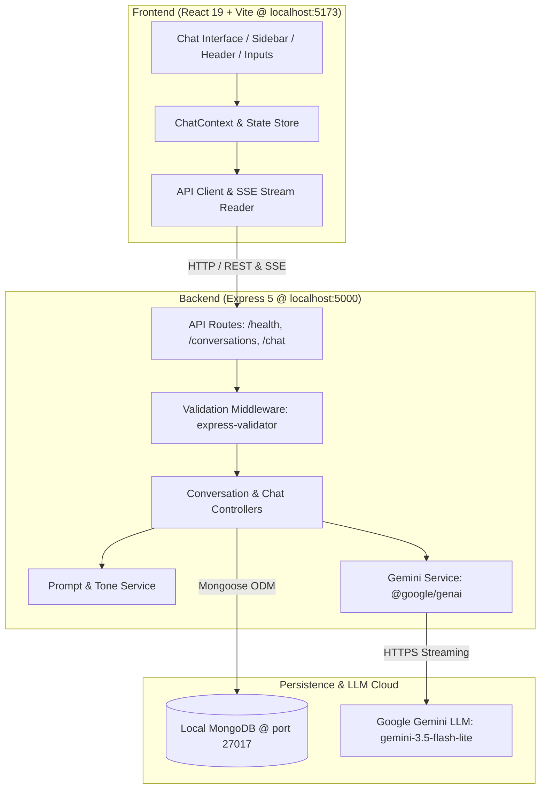

# Quantiphi AI Chat Assistant

A full-stack, enterprise-grade AI Chat Assistant built with **React**, **Node.js + Express**, **MongoDB (local)**, and **Google Gemini LLM** using the official `@google/genai` SDK with real-time **Server-Sent Events (SSE)** response streaming and dynamic **tone control**.

---

## Table of Contents

1. [Project Overview](#project-overview)
2. [Key Features](#key-features)
3. [Technology Stack](#technology-stack)
4. [Project Architecture](#project-architecture)
5. [Folder Structure](#folder-structure)
6. [Prerequisites](#prerequisites)
7. [Local MongoDB Setup](#local-mongodb-setup)
8. [Environment Variable Configuration](#environment-variable-configuration)
9. [Installation & Setup](#installation--setup)
10. [Running the Application](#running-the-application)
11. [Testing Suite](#testing-suite)
12. [Production Build](#production-build)
13. [API Documentation](#api-documentation)
14. [Streaming Implementation Details](#streaming-implementation-details)
15. [Tone Control Engine](#tone-control-engine)
16. [Additional Features](#additional-features)
17. [Troubleshooting Guide](#troubleshooting-guide)
18. [Viva / Technical Interview Q&A](#viva--technical-interview-qa)

---

## Project Overview

The **Quantiphi AI Chat Assistant** is an end-to-end conversational AI platform designed for technical professionals, students, and developers. It allows users to create persistent multi-turn conversations, select assistant behavioral tones (Professional, Casual, Concise), stream live AI completions token-by-token from Google Gemini models, regenerate answers on-the-fly, and export complete conversation transcripts in formatted Markdown or clean plain text.

The application adheres strictly to modern web security and architecture standards: API keys are securely quarantined on the backend, MongoDB handles atomic message persistence, and client-side state dynamically synchronizes with optimistic updates and stream interruption controls.

---

## Key Features

- **Real-Time Gemini Streaming**: Live, progressive token streaming powered by Server-Sent Events (SSE) using `@google/genai`.
- **Tri-Tone Control Engine**:
  - **Professional**: Authoritative, structured, and comprehensive with headers, code blocks, and markdown tables.
  - **Casual**: Friendly, warm, conversational, and approachable with relatable analogies and subtle emojis.
  - **Concise**: Direct, punchy, bulleted answers stripped of conversational filler while preserving technical depth.
- **Full Conversation Context Memory**: Maintains preceding turns across the active conversation up to 20 recent messages so Gemini understands conversational references.
- **Local MongoDB Persistence**: All conversations, titles, message roles, tones, and timestamps persist in a local MongoDB database (`quantiphi_ai_chat`).
- **Response Regeneration**: One-click regeneration of the latest AI response reusing the original prompt while applying the current tone.
- **Dual Format Export**:
  - **Markdown (`.md`)**: Full markdown document with conversation metadata, timestamps, and formatted code/quotes.
  - **Plain Text (`.txt`)**: Clean ASCII-bordered text transcript suitable for notes or copy-pasting.
- **Dynamic Auto-Naming**: Automatically renames "New Conversation" based on the user's initial prompt turn.
- **Inline Conversation Management**: Create, rename inline, or delete conversations with confirmation modals.
- **Responsive Layout**: Designed for desktops and mobile viewports with an adaptive slide-out sidebar and auto-expanding input box.
- **Robust Error & Loading States**: Real-time typing dots, disabled states during generation, instant stop button, and dismissible error alerts.

---

## Technology Stack

| Layer | Technologies / Packages | Purpose |
|---|---|---|
| **Frontend** | React 19, Vite 8, Lucide React | Single-page responsive chat interface |
| **Markdown** | `react-markdown`, `remark-gfm` | Formatted code snippets, tables, blockquotes |
| **Frontend Testing** | Vitest 5, `@testing-library/react`, `jsdom` | Component and UI state verification |
| **Backend** | Node.js (v22), Express 5 | REST API and SSE streaming server |
| **Database** | MongoDB (Local), Mongoose 9 | Document persistence and schema validation |
| **AI / LLM** | `@google/genai` (Official SDK) | Google Gemini API integration and streaming |
| **Security & Utilities** | `cors`, `helmet`, `dotenv`, `express-validator` | Security headers, CORS policy, input validation |
| **Backend Testing** | Node.js Native Test Runner (`node --test`), `supertest` | Automated API endpoint and integration tests |

---

## Project Architecture



---

## Folder Structure

```
Chat Assistant - Quantiphi/
├── .env.example                     # Environment template for backend and frontend
├── .gitignore                       # Git exclusion list (node_modules, .env, dist)
├── README.md                        # Complete project documentation and viva preparation
│
├── Backend/                         # Express.js REST API & Gemini Streaming Server
│   ├── .env                         # Server environment variables (Protected, not committed)
│   ├── package.json                 # Backend dependencies and scripts
│   ├── src/
│   │   ├── app.js                   # Express application setup, security, routes
│   │   ├── index.js                 # Server entry point, DB initialization, graceful shutdown
│   │   ├── config/
│   │   │   ├── database.js          # Mongoose connection & lifecycle events
│   │   │   └── env.js               # Validated environment configuration
│   │   ├── controllers/
│   │   │   ├── chatController.js    # SSE streaming & response regeneration
│   │   │   └── conversationController.js # CRUD for conversations
│   │   ├── middleware/
│   │   │   ├── errorHandler.js      # Centralized error handler
│   │   │   ├── notFound.js          # 404 Route handler
│   │   │   └── validation.js        # express-validator rules
│   │   ├── models/
│   │   │   └── Conversation.js      # Mongoose Schema (Conversation + Messages)
│   │   ├── routes/
│   │   │   ├── conversationRoutes.js# /api/conversations routes
│   │   │   └── healthRoutes.js      # /api/health route
│   │   └── services/
│   │       ├── geminiService.js     # @google/genai streaming service
│   │       └── promptService.js     # Tone instructions & history context builder
│   └── tests/
│       ├── api.test.js              # Integration test suite for all endpoints
│       └── promptService.test.js    # Unit tests for tone prompt builder
│
└── Frontend/                        # React 19 + Vite Single Page Application
    ├── index.html                   # HTML entry point
    ├── package.json                 # Frontend dependencies and scripts
    ├── vite.config.js               # Vite bundler configuration with dev proxy & vitest
    ├── public/                      # Static SVG icons and favicon
    └── src/
        ├── App.jsx                  # Main application component
        ├── main.jsx                 # React root bootstrap
        ├── index.css                # Custom CSS design system (tokens, components, responsive)
        ├── components/
        │   ├── ChatHeader.jsx       # Header with active title, tone selector, export dropdown
        │   ├── ChatWindow.jsx       # Scrollable chat messages, auto-scroll ref, welcome screen
        │   ├── ErrorBanner.jsx      # Dismissible error notification
        │   ├── MessageBubble.jsx    # User & assistant bubbles, markdown, copy & regenerate
        │   ├── MessageInput.jsx     # Auto-expanding text area, stop button, send button
        │   ├── Sidebar.jsx          # Conversation history, new chat, rename, delete modal
        │   ├── ToneSelector.jsx     # Professional / Casual / Concise switch
        │   ├── TypingIndicator.jsx  # Animated typing dots and live token stream preview
        │   └── WelcomeScreen.jsx    # Initial landing screen with 4 clickable suggested prompts
        ├── context/
        │   └── ChatContext.jsx      # Centralized chat state provider and actions
        ├── services/
        │   └── api.js               # Real backend Fetch API client with SSE stream parser
        └── test/
            ├── setup.js             # Vitest DOM environment setup
            ├── MessageBubble.test.jsx
            ├── ToneSelector.test.jsx
            └── WelcomeScreen.test.jsx
```

---

## Prerequisites

Before starting the application, ensure the following are installed on your machine:

1. **Node.js**: v18.0.0 or higher (v20+ or v22 recommended). Verify with:
   ```bash
   node -v
   ```
2. **npm**: Node Package Manager (comes bundled with Node.js). Verify with:
   ```bash
   npm -v
   ```
3. **MongoDB Community Server**: Local MongoDB instance running on port `27017`.

---

## Local MongoDB Setup

This application connects to a **locally installed MongoDB** service:
```
mongodb://127.0.0.1:27017/quantiphi_ai_chat
```

### Windows
1. Verify if MongoDB is installed at `C:\Program Files\MongoDB\Server\<version>\bin`.
2. Start MongoDB as a Windows service:
   ```powershell
   net start MongoDB
   ```
   Or launch `mongod` directly in a terminal:
   ```powershell
   & "C:\Program Files\MongoDB\Server\8.2\bin\mongod.exe" --dbpath "C:\Program Files\MongoDB\Server\8.2\data"
   ```

### macOS (Homebrew)
```bash
brew services start mongodb-community@7.0
```

### Linux (systemd)
```bash
sudo systemctl start mongod
sudo systemctl enable mongod
```

To test connectivity manually:
```bash
mongosh mongodb://127.0.0.1:27017/quantiphi_ai_chat
```

---

## Environment Variable Configuration

The project includes `.env.example` in the root folder. Configure `Backend/.env` with your settings:

```env
# Backend Server Configuration
PORT=5000
CLIENT_URL=http://localhost:5173

# Local MongoDB Connection String
MONGODB_URI=mongodb://127.0.0.1:27017/quantiphi_ai_chat

# Google Gemini API Settings
GEMINI_API_KEY=your_actual_gemini_api_key_here
GEMINI_MODEL=gemini-3.5-flash-lite
```

> **Security Note**: Never commit `Backend/.env` to source control. The root `.gitignore` excludes all `.env` files. The frontend accesses Gemini solely through backend proxies and never receives the API key.

---

## Installation & Setup

1. **Clone or open the repository**:
   ```bash
   cd "Chat Assistant - Quantiphi"
   ```

2. **Install Backend dependencies**:
   ```bash
   cd Backend
   npm install
   cd ..
   ```

3. **Install Frontend dependencies**:
   ```bash
   cd Frontend
   npm install
   cd ..
   ```

---

## Running the Application

### 1. Start the Backend Server
In a terminal, navigate to the `Backend` directory:
```bash
cd Backend
npm start
```
*Output will indicate:*
```
Connected to MongoDB: quantiphi_ai_chat
Server running on http://localhost:5000
```

For development auto-restart with Node watch mode:
```bash
npm run dev
```

### 2. Start the Frontend Client
In a second terminal, navigate to the `Frontend` directory:
```bash
cd Frontend
npm run dev
```
*Output:*
```
  VITE v8.3.6  ready in 240 ms

  ➜  Local:   http://localhost:5173/
  ➜  Network: use --host to expose
```

### 3. Open in Browser
Visit **`http://localhost:5173`** in Chrome, Edge, Firefox, or Safari.

---

## Testing Suite

The repository includes comprehensive automated test suites for both frontend and backend.

### Running Backend Tests
Executes native Node.js integration tests with `supertest` testing health endpoints, validation rules, conversation CRUD, prompt generation, and MongoDB persistence:
```bash
cd Backend
npm test
```
*Actual Results:*
```
✔ API Endpoints Integration Suite (11 tests passed)
  ✔ GET /api/health should return 200 with status ok and mongoStatus
  ✔ GET /api/unknown-endpoint should return 404 Route not found
  ✔ GET /api/conversations/:id with invalid MongoId should return 400 validation error
  ✔ PATCH /api/conversations/:id with invalid MongoId should return 400 validation error
  ✔ POST /api/conversations/:id/chat with missing content should return 400
  ✔ POST /api/conversations/:id/chat with invalid tone should return 400
  ✔ GET /api/conversations/:id with non-existent ID should return 404
  ✔ POST /api/conversations should create a new conversation and persist it
  ✔ GET /api/conversations should list conversations including the newly created one
  ✔ GET /api/conversations/:id should retrieve the conversation by ID
  ✔ PATCH /api/conversations/:id should rename the conversation title
  ✔ DELETE /api/conversations/:id should delete the conversation
✔ PromptService Suite (6 tests passed)
  ✔ should generate professional tone instructions
  ✔ should generate casual tone instructions
  ✔ should generate concise tone instructions
  ✔ should default to professional tone for unknown or undefined tone
  ✔ should format message history correctly for @google/genai contents
  ✔ should limit conversation history to maximum recent context turns
```

### Running Frontend Tests
Executes Vitest in a virtual DOM environment testing component rendering, tone toggles, message bubble interactions, copy clipboard commands, and suggested prompt dispatch:
```bash
cd Frontend
npm test
```
*Actual Results:*
```
 ✓ src/test/ToneSelector.test.jsx (2 tests)
 ✓ src/test/WelcomeScreen.test.jsx (2 tests)
 ✓ src/test/MessageBubble.test.jsx (4 tests)

 Test Files  3 passed (3)
      Tests  8 passed (8)
```

---

## Production Build

To build the optimized static production bundle for the frontend:
```bash
cd Frontend
npm run build
```
*Output:*
```
vite v8.3.6 building client environment for production...
✓ 2382 modules transformed.
dist/index.html                   0.47 kB │ gzip:   0.31 kB
dist/assets/index-Q9ZOrUpy.css   11.89 kB │ gzip:   2.74 kB
dist/assets/index-bAsSlWw5.js   415.47 kB │ gzip: 128.52 kB
✓ built in 2.80s
```

You can preview the built bundle with:
```bash
npm run preview
```

---

## API Documentation

### 1. Health Check
- **`GET /api/health`**
- **Response `200 OK`**:
  ```json
  {
    "status": "ok",
    "mongoStatus": "connected",
    "timestamp": "2026-11-19T11:00:00.000Z",
    "uptime": 124.52
  }
  ```

### 2. Conversation Management
- **`GET /api/conversations`**
  - Returns array of all conversations sorted by last update date.
  - Response: `200 OK`
  ```json
  [
    {
      "_id": "673c683b584061a7a0b38001",
      "title": "Understanding Node.js Event Loop",
      "messageCount": 4,
      "lastMessage": "The event loop manages asynchronous I/O...",
      "createdAt": "2026-11-19T10:30:00.000Z",
      "updatedAt": "2026-11-19T10:32:00.000Z"
    }
  ]
  ```

- **`POST /api/conversations`**
  - Body: `{ "title": "Optional Title" }`
  - Response: `201 Created`

- **`GET /api/conversations/:id`**
  - Retrieves full conversation including message history.
  - Response: `200 OK` or `404 Not Found`

- **`PATCH /api/conversations/:id`**
  - Body: `{ "title": "New Title" }`
  - Response: `200 OK`

- **`DELETE /api/conversations/:id`**
  - Deletes conversation and all associated messages.
  - Response: `200 OK` `{ "message": "Conversation deleted successfully", "id": "..." }`

### 3. Real-Time Streaming Chat
- **`POST /api/conversations/:id/chat`**
  - Headers: `Accept: text/event-stream`
  - Body:
    ```json
    {
      "content": "Explain microservices architecture in 3 points",
      "tone": "professional"
    }
    ```
  - **SSE Protocol Events**:
    - `event: token`
      `data: {"token":"Microservices "}`
    - `event: token`
      `data: {"token":"architecture "}`
    - `event: done`
      `data: {"message":{"_id":"...","role":"assistant","content":"...","timestamp":"..."},"conversationId":"..."}`
    - `event: error`
      `data: {"error":"Model currently overloaded. Please retry."}`

### 4. Regenerate Response
- **`POST /api/conversations/:id/regenerate`**
  - Headers: `Accept: text/event-stream`
  - Body: `{ "tone": "concise" }`
  - Strips previous assistant response and streams fresh replacement.

---

## Streaming Implementation Details

1. **Protocol Choice**: Server-Sent Events (SSE) over HTTP POST. Unlike WebSockets which require complex handshake and connection management, SSE uses standard HTTP streaming with lightweight overhead and full proxy compatibility.
2. **Buffer Management**: The server sets `X-Accel-Buffering: no` and calls `res.flushHeaders()` immediately to prevent Nginx or intermediate proxies from buffering tokens.
3. **Atomic Persistence**:
   - The user message is saved to MongoDB immediately before the LLM request is initiated.
   - Assistant tokens are streamed progressively to the client.
   - Only upon full completion of the LLM stream without interruption is the assistant response committed to MongoDB.
4. **Client Interruption Handling**: If the user clicks the "Stop" button or navigates away, the client calls `AbortController.abort()`. The backend detects the socket closure (`req.on('close')`), passes the abort signal to the Gemini SDK, and terminates generation without storing an incomplete response.

---

## Tone Control Engine

The selected tone is sent to the backend with every request and injected into Gemini's `config.systemInstruction`:

```javascript
// Backend: src/services/promptService.js
const TONE_INSTRUCTIONS = {
  professional:
    "You are Quantiphi AI, an intelligent, professional, clear, respectful, and well-structured assistant. " +
    "Provide thorough explanations, organized formatting with headers, bullet points, and code blocks where helpful.",

  casual:
    "You are Quantiphi AI, a friendly, natural, approachable, conversational, and enthusiastic assistant. " +
    "Use casual language, conversational analogies, and emojis sparingly where appropriate.",

  concise:
    "You are Quantiphi AI, a direct, concise, and to-the-point assistant. " +
    "Deliver brief, punchy answers that get straight to the facts without unnecessary filler while preserving accuracy."
};
```

Switching the tone on the frontend immediately alters the persona of subsequent replies without reloading the page or losing conversation history.

---

## Additional Features

### 1. Response Regeneration
- The **Regenerate** button appears directly beneath the latest assistant message.
- Clicking Regenerate re-evaluates the prior user turn under the currently active tone.
- The UI transitions into the streaming state, updates the message in place, and stores the updated response in MongoDB.

### 2. Conversation Export
- Accessible from the **Export** dropdown in the top header.
- **Markdown Export (`.md`)**:
  - Generates a GitHub-flavored markdown file containing conversation title, export timestamp, message counts, and clear `### You` / `### Quantiphi AI` headers with code block fences preserved.
- **Plain Text Export (`.txt`)**:
  - Generates an ASCII-bordered clean text transcript with bracketed roles `[You]` and `[AI Assistant]` with timestamps.
- Triggers a direct browser file download with sanitized filenames.

---

## Troubleshooting Guide

| Issue | Root Cause | Solution |
|---|---|---|
| `MONGO ERROR: connect ECONNREFUSED 127.0.0.1:27017` | Local MongoDB service is not started | Run `net start MongoDB` or start `mongod.exe` manually. |
| `GEMINI ERROR: 404 NOT_FOUND` | Configured Gemini model is retired or invalid | Ensure `GEMINI_MODEL=gemini-3.5-flash-lite` in `Backend/.env`. |
| `API Key Missing Warning` | `GEMINI_API_KEY` is not defined in `Backend/.env` | Add your valid Gemini API key to `Backend/.env`. |
| `CORS Error in Browser` | Frontend running on non-whitelisted port | Ensure backend `CLIENT_URL` matches your frontend port (default: `http://localhost:5173`). |
| `Build Failure: cannot find module` | Dependencies missing in subfolder | Run `npm install` inside both `Backend` and `Frontend` directories. |

---

## Viva / Technical Interview Q&A

### 1. React Architecture & State Management
**Q: Why was `useContext` chosen over Redux or Zustand for this chat application?**
> **A:** The chat application state comprises active conversation data, streaming buffer, conversation list, and tone. `React.createContext` combined with custom hooks (`useChat`) provides clean encapsulation and reactivity with zero bundle overhead.

**Q: How does the application avoid re-rendering the entire message list during rapid token streaming?**
> **A:** The live streaming text is maintained in a dedicated `streamingText` state consumed only by the active `TypingIndicator` / active bubble component. Completed messages remain memoized or static in the messages array until the stream concludes.

**Q: How is auto-scroll implemented without causing jitter during reading?**
> **A:** An invisible sentinel `div` (`messagesEndRef`) is placed at the end of the message list. A `useEffect` hook triggers `scrollIntoView({ behavior: 'smooth' })` when `messages.length` changes or when new streaming tokens arrive.

---

### 2. Express Backend & Server-Sent Events (SSE)
**Q: What is Server-Sent Events (SSE) and why is it preferred over WebSockets here?**
> **A:** SSE is a unidirectional protocol over standard HTTP where the server streams UTF-8 events (`text/event-stream`) to the client. Because chat generation only streams from server to client, SSE avoids WebSocket framing complexity, works natively with HTTP/2 and CORS, and automatically reconnects.

**Q: How do you prevent intermediate reverse proxies (e.g., Nginx) from buffering SSE tokens?**
> **A:** We set the header `'X-Accel-Buffering': 'no'`, configure `'Cache-Control': 'no-cache'`, and immediately flush response headers via `res.flushHeaders()` before writing the first chunk.

**Q: How is centralized error handling structured in Express 5?**
> **A:** An error-handling middleware with signature `(err, req, res, next)` catches unhandled synchronous and asynchronous exceptions. It identifies error types (such as Mongoose `ValidationError` or `CastError`), maps them to status 400, and returns standardized `{ error: err.message }` without exposing internal stack traces.

---

### 3. Gemini LLM & `@google/genai` SDK
**Q: How does the official `@google/genai` SDK differ from legacy libraries?**
> **A:** The `@google/genai` SDK is Google's unified client for Gemini 2.x and 3.x models. It supports native async iterable streaming (`ai.models.generateContentStream`), structured parameters (`contents` with roles `user` and `model`), and dedicated `config.systemInstruction` parameters.

**Q: How is conversational memory handled when talking to Gemini?**
> **A:** The backend `promptService` retrieves the conversation's message history from MongoDB, formats each message into `{ role: msg.role === 'user' ? 'user' : 'model', parts: [{ text: msg.content }] }`, applies a sliding window of the last 20 messages, and appends the current user prompt turn.

**Q: How are tone changes enforced at the model level?**
> **A:** Rather than prepending text to user prompts, tone is passed directly into `config.systemInstruction`. This keeps system behavioral guidance isolated from the user's conversational turns.

---

### 4. MongoDB & Mongoose Modeling
**Q: What is the benefit of embedding messages within the Conversation document rather than a separate collection?**
> **A:** In a chat assistant, messages are always loaded, deleted, and exported in the context of their conversation. Embedding messages as a subdocument array ensures atomic single-document reads/writes, eliminates multi-collection joins, and automatically cascades deletions.

**Q: How do we prevent unbounded document growth in MongoDB?**
> **A:** We limit the context sent to Gemini to the latest 20 turns, and MongoDB's 16MB document size limit easily accommodates thousands of text messages per conversation.

---

### 5. Security & Production Readiness
**Q: Where is the Gemini API key stored, and how is it protected?**
> **A:** The API key is stored strictly on the server in `Backend/.env`. It is read by Node via `process.env.GEMINI_API_KEY` and never transmitted to the client, logged to console, or included in client build bundles.

**Q: What security headers are applied to the Express backend?**
> **A:** `helmet()` is applied at the root of the Express pipeline, configuring Content Security Policy (CSP), HTTP Strict Transport Security (HSTS), X-Content-Type-Options, and frameguard protections.
